# J97 News Analyst - Flow Diagram

## Mermaid Flowchart

```mermaid
flowchart TD
    A[🚀 J97 News Analyst Start] --> B[📋 Load Configuration]
    B --> C[🔑 Load API Keys]
    C --> D[🔍 Test All APIs]
    
    D --> E{All APIs Working?}
    E -->|No| F[❌ Log Error & Exit]
    E -->|Yes| G[📡 Start Priority-Based Crawling]
    
    G --> H[🔄 GNews API - Priority 1]
    H --> I{GNews Success?}
    I -->|Yes| J[📰 Process GNews Articles]
    I -->|No| K[⚠️ Log GNews Error]
    
    K --> L[🔄 NewsAPI - Priority 2]
    J --> M{Enough Articles?}
    M -->|Yes| N[🎯 Stop Crawling]
    M -->|No| L
    
    L --> O{NewsAPI Success?}
    O -->|Yes| P[📰 Process NewsAPI Articles]
    O -->|No| Q[⚠️ Log NewsAPI Error]
    
    Q --> R[🔄 NewsData - Priority 3]
    P --> S{Enough Articles?}
    S -->|Yes| N
    S -->|No| R
    
    R --> T{NewsData Success?}
    T -->|Yes| U[📰 Process NewsData Articles]
    T -->|No| V[⚠️ Log NewsData Error]
    
    V --> W[🔄 Mediastack - Priority 4]
    U --> X{Enough Articles?}
    X -->|Yes| N
    X -->|No| W
    
    W --> Y{Mediastack Success?}
    Y -->|Yes| Z[📰 Process Mediastack Articles]
    Y -->|No| AA[⚠️ Log Mediastack Error]
    
    Z --> BB{Enough Articles?}
    BB -->|Yes| N
    BB -->|No| CC[📊 Continue with Available Articles]
    
    AA --> CC
    N --> CC
    
    CC --> DD[🧠 Analyze Articles]
    DD --> EE[📊 Calculate Sentiment Scores]
    EE --> FF[🏷️ Categorize Articles]
    FF --> GG[📈 Calculate Impact Scores]
    GG --> HH[🔑 Extract Key Phrases]
    HH --> II[📊 Generate Trading Signal]
    
    II --> JJ[💾 Store in Supabase]
    JJ --> KK[📰 Store Articles Table]
    KK --> LL[📊 Store Daily Report Table]
    LL --> MM[✅ Analysis Complete]
    
    MM --> NN{Mode = Continuous?}
    NN -->|Yes| OO[⏰ Sleep 1 Hour]
    NN -->|No| PP[🏁 End Analysis]
    
    OO --> G
    PP --> QQ[📋 Generate Final Report]
    QQ --> RR[💾 Save Summary JSON]
    RR --> SS[🎉 J97 Analysis Complete]
```

## Text Description of J97 Flow

### 1. **Initialization Phase**
- **Load Configuration**: Đọc cấu hình từ `api_keys.env`
- **Load API Keys**: Load 4 API keys (GNews, NewsAPI, NewsData, Mediastack)
- **Test All APIs**: Kiểm tra kết nối và tính khả dụng của tất cả APIs

### 2. **Priority-Based News Crawling**
J97 sử dụng hệ thống ưu tiên và fallback:

#### **Priority 1: GNews API**
- **Query**: `ethereum OR eth OR "ethereum 2.0" OR "ethereum merge" OR "ethereum upgrade" OR "ethereum staking" OR "ethereum gas" OR "ethereum defi" OR "ethereum ETF" OR "ETH ETF" OR "Ethereum Blackrock" OR "ethereum layer 2" OR "ethereum rollup" OR "ethereum price" OR "ethereum news" OR "ethereum reserve" OR "ethereum sell" OR "ethereum buy" OR "ethereum accumulate"`
- **Rate Limit**: 10 articles per request (free tier)
- **Fallback**: Nếu GNews fail → chuyển sang NewsAPI

#### **Priority 2: NewsAPI**
- **Query**: Cùng keywords như GNews
- **Rate Limit**: 50 articles per request
- **Fallback**: Nếu NewsAPI fail → chuyển sang NewsData

#### **Priority 3: NewsData**
- **Query**: Cùng keywords như GNews
- **Rate Limit**: 50 articles per request
- **Fallback**: Nếu NewsData fail → chuyển sang Mediastack

#### **Priority 4: Mediastack**
- **Query**: Cùng keywords như GNews
- **Rate Limit**: 50 articles per request
- **Fallback**: Nếu Mediastack fail → sử dụng articles đã có

### 3. **Article Processing**
- **Deduplication**: Loại bỏ articles trùng lặp
- **Filtering**: Chỉ giữ articles liên quan đến ETH
- **Validation**: Kiểm tra title, description, URL hợp lệ

### 4. **Analysis Phase**

#### **Sentiment Analysis**
- **VADER Sentiment**: Phân tích sentiment cơ bản
- **TextBlob Sentiment**: Phân tích sentiment nâng cao
- **Combined Score**: Kết hợp 2 phương pháp

#### **Categorization**
- **General**: Tin tức chung về ETH
- **Market**: Giá cả, thị trường ETH
- **Protocol Upgrade**: Cập nhật giao thức ETH
- **Regulation**: Quy định pháp lý
- **Staking**: ETH staking
- **DeFi**: DeFi trên ETH
- **Scaling**: Layer 2, rollups

#### **Impact Scoring**
- **Title Impact**: Tác động của tiêu đề
- **Content Impact**: Tác động của nội dung
- **Source Impact**: Tác động của nguồn tin
- **Combined Impact**: Điểm tác động tổng hợp

#### **Key Phrase Extraction**
- **Frequency Analysis**: Phân tích tần suất từ khóa
- **Relevance Scoring**: Điểm độ liên quan
- **Top Phrases**: Top 10 key phrases

### 5. **Trading Signal Generation**
- **Sentiment Threshold**: Ngưỡng sentiment
- **Impact Threshold**: Ngưỡng tác động
- **Confidence Calculation**: Tính toán độ tin cậy
- **Signal Logic**: Logic tạo tín hiệu (BUY/SELL/HOLD)

### 6. **Data Storage (Supabase)**

#### **Articles Table (`j97_news_articles`)**
- **id**: UUID primary key
- **title**: Tiêu đề bài viết
- **description**: Mô tả bài viết
- **url**: URL bài viết (unique)
- **image_url**: URL hình ảnh
- **published_at**: Thời gian xuất bản
- **source_name**: Tên nguồn
- **source_url**: URL nguồn
- **api_source**: API được sử dụng
- **keywords_detected**: Từ khóa phát hiện
- **sentiment_score**: Điểm sentiment
- **sentiment_magnitude**: Độ lớn sentiment
- **category**: Danh mục
- **impact_score**: Điểm tác động
- **analysis_timestamp**: Thời gian phân tích

#### **Daily Reports Table (`j97_daily_reports`)**
- **id**: UUID primary key
- **date**: Ngày báo cáo (unique)
- **total_articles**: Tổng số bài viết
- **trading_signal**: Tín hiệu giao dịch
- **categories**: Phân bố danh mục
- **sentiment_breakdown**: Phân bố sentiment
- **top_key_phrases**: Top key phrases
- **high_impact_articles**: Số bài viết tác động cao
- **high_impact_titles**: Tiêu đề bài viết tác động cao
- **created_at**: Thời gian tạo

### 7. **Output Generation**
- **Console Report**: Báo cáo trên console
- **JSON Summary**: Lưu summary vào file JSON
- **Supabase Storage**: Lưu vào database

### 8. **Continuous Mode**
- **Sleep Interval**: 1 giờ giữa các lần chạy
- **Loop**: Lặp lại quá trình phân tích
- **Error Handling**: Xử lý lỗi và tiếp tục

## Key Features

### **Priority & Fallback System**
- **4 APIs** với thứ tự ưu tiên rõ ràng
- **Automatic Fallback** khi API cao hơn fail
- **Rate Limit Management** cho từng API

### **ETH-Focused Analysis**
- **19 Keywords** tập trung vào ETH
- **Comprehensive Coverage** tất cả aspects của ETH
- **Real-time Processing** tin tức mới nhất

### **Advanced Analytics**
- **Dual Sentiment Analysis** (VADER + TextBlob)
- **Multi-category Classification**
- **Impact Scoring Algorithm**
- **Trading Signal Generation**

### **Robust Data Storage**
- **Deduplication** tránh trùng lặp
- **Structured Storage** trong Supabase
- **Error Handling** cho database operations

### **Scalable Architecture**
- **Modular Design** dễ mở rộng
- **Configuration-driven** thông qua env files
- **Logging System** đầy đủ cho debugging

