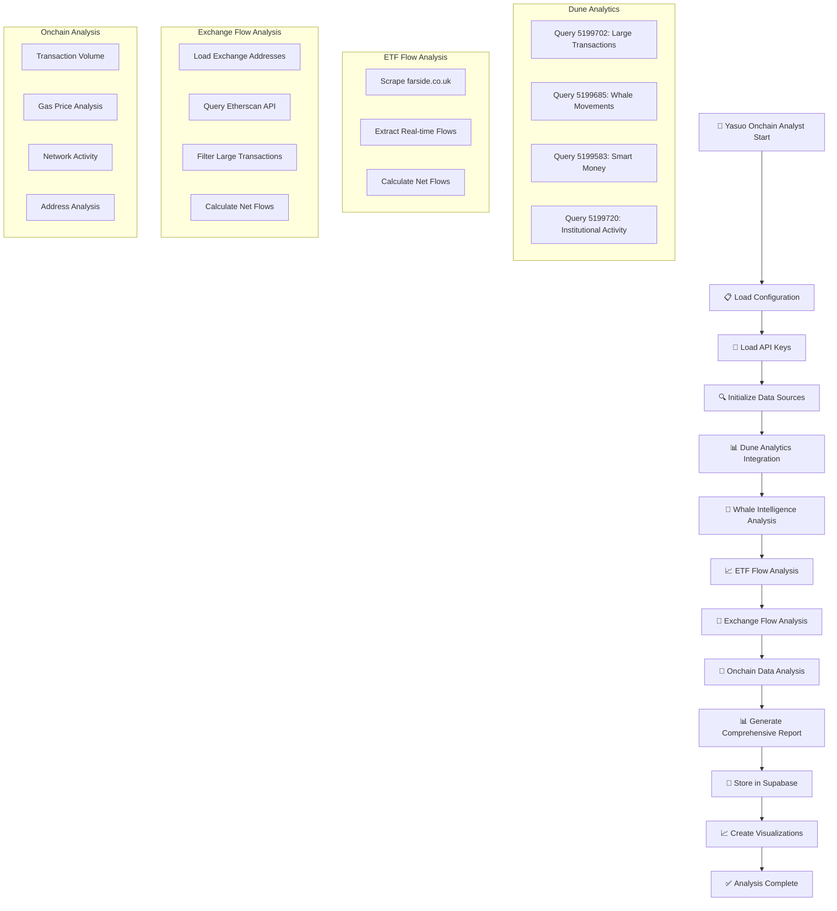

# Yasuo - Onchain Analyst Flow Diagram

## Mermaid Flowchart



## Text Flow Diagram

```
┌─────────────────────────────────────────────────────────────────────────────────┐
│                        YASUO ONCHAIN ANALYST FLOW DIAGRAM                      │
└─────────────────────────────────────────────────────────────────────────────────┘

🚀 START
    │
    ▼
┌─────────────────────────────────────────────────────────────────────────────────┐
│                            INITIALIZATION PHASE                                │
└─────────────────────────────────────────────────────────────────────────────────┘

📋 Load Configuration
    │
    ▼
🔑 Load API Keys
    ├─ Dune API Key: vYxFYMWxE0Ph4Y3FdUARt7CPhxVMbko9
    ├─ Etherscan API Key: 83YY4NJW29KN699ITZVHTQGF3M8RC9QTU6
    └─ Supabase Credentials
    │
    ▼
🔍 Initialize Data Sources
    ├─ Dune Analytics Client
    ├─ Etherscan API Client
    ├─ ETF Tracker (farside.co.uk)
    └─ Supabase Client
    │
    ▼
┌─────────────────────────────────────────────────────────────────────────────────┐
│                        DUNE ANALYTICS INTEGRATION                              │
└─────────────────────────────────────────────────────────────────────────────────┘

📊 Dune Analytics Integration
    │
    ▼
🐋 Whale Intelligence Analysis
    │
    ▼
┌─────────────────────────────────────────────────────────────────────────────────┐
│ Query 5199702: Large Transactions (>1000 ETH)                                 │
│ • Transaction Hash                                                              │
│ • From Address                                                                  │
│ • To Address                                                                    │
│ • ETH Amount                                                                    │
│ • Timestamp                                                                     │
│ • Gas Price                                                                     │
└─────────────────────────────────────────────────────────────────────────────────┘
    │
    ▼
┌─────────────────────────────────────────────────────────────────────────────────┐
│ Query 5199685: Whale Movements                                                 │
│ • Whale Address                                                                 │
│ • Transaction Count                                                             │
│ • Total ETH Volume                                                              │
│ • Average Transaction Size                                                      │
│ • Time Range                                                                    │
└─────────────────────────────────────────────────────────────────────────────────┘
    │
    ▼
┌─────────────────────────────────────────────────────────────────────────────────┐
│ Query 5199583: Smart Money Activity                                            │
│ • Smart Money Addresses                                                        │
│ • Investment Patterns                                                          │
│ • Portfolio Changes                                                             │
│ • Risk Assessment                                                              │
└─────────────────────────────────────────────────────────────────────────────────┘
    │
    ▼
┌─────────────────────────────────────────────────────────────────────────────────┐
│ Query 5199720: Institutional Activity                                          │
│ • Institutional Addresses                                                      │
│ • Large Transactions                                                           │
│ • Market Impact Analysis                                                       │
│ • Trend Analysis                                                               │
└─────────────────────────────────────────────────────────────────────────────────┘
    │
    ▼
┌─────────────────────────────────────────────────────────────────────────────────┐
│                            ETF FLOW ANALYSIS                                   │
└─────────────────────────────────────────────────────────────────────────────────┘

📈 ETF Flow Analysis
    │
    ▼
┌─────────────────────────────────────────────────────────────────────────────────┐
│ Scrape farside.co.uk                                                           │
│ • ETH ETF Flows                                                                │
│ • Real-time Data                                                               │
│ • Historical Trends                                                            │
│ • Net Flow Calculation                                                         │
└─────────────────────────────────────────────────────────────────────────────────┘
    │
    ▼
┌─────────────────────────────────────────────────────────────────────────────────┐
│ ETF Flow Results:                                                              │
│ • Total Inflows: $X million                                                    │
│ • Total Outflows: $Y million                                                   │
│ • Net Flow: $Z million                                                         │
│ • Flow Trend: Positive/Negative                                                │
└─────────────────────────────────────────────────────────────────────────────────┘
    │
    ▼
┌─────────────────────────────────────────────────────────────────────────────────┐
│                            EXCHANGE FLOW ANALYSIS                              │
└─────────────────────────────────────────────────────────────────────────────────┘

💱 Exchange Flow Analysis
    │
    ▼
┌─────────────────────────────────────────────────────────────────────────────────┐
│ Load Exchange Addresses (exchange_addresses.json)                              │
│ • Binance: 0x3f5CE5FBFe3E9af3971dD833D26bA9b5C936f0bE                         │
│ • Coinbase: 0xA9D1E08C7793af67e9d92fe308d5697FB81D3E7                        │
│ • Kraken: 0x2910543Af39abA0Cd09dbb2D50200b3E800A63D2                         │
│ • Huobi: 0x46705dfff24256421A05d056c29E81Bdc09723B8                          │
│ • OKEx: 0x6cc5F688a315f3dC91Ae2F6B2F2C1b8E6F66c97c                         │
│ • And 50+ more exchange addresses...                                           │
└─────────────────────────────────────────────────────────────────────────────────┘
    │
    ▼
┌─────────────────────────────────────────────────────────────────────────────────┐
│ Query Etherscan API                                                             │
│ • Filter: Transactions >50 ETH                                                 │
│ • Time Range: Last 24 hours                                                    │
│ • Address Filter: Exchange addresses only                                      │
│ • Transaction Type: Both incoming and outgoing                                 │
└─────────────────────────────────────────────────────────────────────────────────┘
    │
    ▼
┌─────────────────────────────────────────────────────────────────────────────────┐
│ Exchange Flow Results:                                                          │
│ • Total Inflows: X ETH                                                         │
│ • Total Outflows: Y ETH                                                        │
│ • Net Flow: Z ETH (Positive = More to exchanges)                              │
│ • Top Exchanges: Binance, Coinbase, Kraken                                    │
└─────────────────────────────────────────────────────────────────────────────────┘
    │
    ▼
┌─────────────────────────────────────────────────────────────────────────────────┐
│                            ONCHAIN DATA ANALYSIS                               │
└─────────────────────────────────────────────────────────────────────────────────┘

🔗 Onchain Data Analysis
    │
    ▼
┌─────────────────────────────────────────────────────────────────────────────────┐
│ Transaction Volume Analysis:                                                    │
│ • Daily Transaction Count                                                       │
│ • Transaction Volume (ETH)                                                     │
│ • Average Transaction Size                                                      │
│ • Volume Trend (7-day, 30-day)                                                 │
└─────────────────────────────────────────────────────────────────────────────────┘
    │
    ▼
┌─────────────────────────────────────────────────────────────────────────────────┐
│ Gas Price Analysis:                                                             │
│ • Current Gas Price (Gwei)                                                     │
│ • Gas Price Trend                                                               │
│ • Network Congestion Level                                                      │
│ • Transaction Cost Analysis                                                    │
└─────────────────────────────────────────────────────────────────────────────────┘
    │
    ▼
┌─────────────────────────────────────────────────────────────────────────────────┐
│ Network Activity Analysis:                                                      │
│ • Active Addresses Count                                                        │
│ • New Addresses Created                                                         │
│ • Network Hash Rate                                                             │
│ • Block Production Rate                                                         │
└─────────────────────────────────────────────────────────────────────────────────┘
    │
    ▼
┌─────────────────────────────────────────────────────────────────────────────────┐
│ Address Analysis:                                                               │
│ • Top Senders by Volume                                                        │
│ • Top Receivers by Volume                                                      │
│ • Address Activity Patterns                                                    │
│ • Suspicious Activity Detection                                                │
└─────────────────────────────────────────────────────────────────────────────────┘
    │
    ▼
┌─────────────────────────────────────────────────────────────────────────────────┐
│                            COMPREHENSIVE REPORT                                │
└─────────────────────────────────────────────────────────────────────────────────┘

📊 Generate Comprehensive Report
    │
    ▼
┌─────────────────────────────────────────────────────────────────────────────────┐
│ Report Components:                                                              │
│ • Executive Summary                                                             │
│ • Whale Intelligence Summary                                                   │
│ • ETF Flow Analysis                                                             │
│ • Exchange Flow Analysis                                                        │
│ • Onchain Metrics Summary                                                       │
│ • Market Sentiment Analysis                                                    │
│ • Risk Assessment                                                               │
│ • Trading Recommendations                                                       │
└─────────────────────────────────────────────────────────────────────────────────┘
    │
    ▼
┌─────────────────────────────────────────────────────────────────────────────────┐
│                            SUPABASE STORAGE                                    │
└─────────────────────────────────────────────────────────────────────────────────┘

💾 Store in Supabase
    │
    ▼
┌─────────────────────────────────────────────────────────────────────────────────┐
│ yasuo_full_snapshot Table:                                                     │
│ • id: UUID primary key                                                         │
│ • analysis_date: Analysis timestamp                                            │
│ • whale_intelligence: JSON object with whale data                              │
│ • etf_flows: JSON object with ETF flow data                                    │
│ • exchange_flows: JSON object with exchange flow data                          │
│ • onchain_metrics: JSON object with onchain data                               │
│ • market_sentiment: JSON object with sentiment analysis                        │
│ • risk_assessment: JSON object with risk metrics                               │
│ • trading_recommendations: JSON object with recommendations                     │
│ • created_at: Creation timestamp                                               │
└─────────────────────────────────────────────────────────────────────────────────┘
    │
    ▼
┌─────────────────────────────────────────────────────────────────────────────────┐
│                            VISUALIZATION                                       │
└─────────────────────────────────────────────────────────────────────────────────┘

📈 Create Visualizations
    │
    ▼
┌─────────────────────────────────────────────────────────────────────────────────┐
│ Visualization Components:                                                       │
│ • Whale Intelligence Dashboard                                                  │
│ • ETF Flow Charts                                                               │
│ • Exchange Flow Charts                                                          │
│ • Onchain Metrics Charts                                                       │
│ • Market Sentiment Charts                                                       │
│ • Risk Assessment Charts                                                        │
└─────────────────────────────────────────────────────────────────────────────────┘
    │
    ▼
┌─────────────────────────────────────────────────────────────────────────────────┐
│                            OUTPUT PHASE                                        │
└─────────────────────────────────────────────────────────────────────────────────┘

✅ Analysis Complete
    │
    ▼
┌─────────────────────────────────────────────────────────────────────────────────┐
│ Final Output:                                                                   │
│ • Console Report with all metrics                                              │
│ • Supabase data storage                                                        │
│ • HTML visualization files                                                     │
│ • JSON summary file                                                             │
│ • Trading recommendations                                                       │
└─────────────────────────────────────────────────────────────────────────────────┘
    │
    ▼
🎉 Yasuo Analysis Complete

┌─────────────────────────────────────────────────────────────────────────────────┐
│                              KEY FEATURES                                      │
└─────────────────────────────────────────────────────────────────────────────────┘

🐋 Whale Intelligence:
   • Large Transactions (>1000 ETH)
   • Whale Movement Patterns
   • Smart Money Activity
   • Institutional Activity

📈 ETF Flow Analysis:
   • Real-time ETF flows from farside.co.uk
   • Inflow/Outflow calculations
   • Net flow trends
   • Market impact assessment

💱 Exchange Flow Analysis:
   • 50+ exchange addresses monitored
   • Transactions >50 ETH filtered
   • Inflow/Outflow calculations
   • Exchange-specific analysis

🔗 Onchain Metrics:
   • Transaction volume analysis
   • Gas price trends
   • Network activity metrics
   • Address activity patterns

📊 Data Sources:
   • Dune Analytics (4 queries)
   • Etherscan API
   • farside.co.uk (ETF data)
   • Supabase (storage)

⚡ Performance:
   • Real-time data processing
   • Comprehensive analysis
   • Automated reporting
   • Data persistence
```

## Detailed Text Description

### **1. INITIALIZATION PHASE (Khởi tạo)**

#### **1.1 Load Configuration**
- **File**: `.env` file with API keys
- **Dune API Key**: `vYxFYMWxE0Ph4Y3FdUARt7CPhxVMbko9`
- **Etherscan API Key**: `83YY4NJW29KN699ITZVHTQGF3M8RC9QTU6`
- **Supabase Credentials**: URL and key for data storage

#### **1.2 Initialize Data Sources**
- **Dune Analytics Client**: For whale intelligence queries
- **Etherscan API Client**: For exchange flow analysis
- **ETF Tracker**: For scraping farside.co.uk
- **Supabase Client**: For data persistence

### **2. DUNE ANALYTICS INTEGRATION (Tích hợp Dune Analytics)**

#### **2.1 Query 5199702: Large Transactions**
- **Purpose**: Track transactions >1000 ETH
- **Data Points**:
  - Transaction Hash
  - From Address
  - To Address
  - ETH Amount
  - Timestamp
  - Gas Price
- **Analysis**: Identify large whale movements

#### **2.2 Query 5199685: Whale Movements**
- **Purpose**: Analyze whale behavior patterns
- **Data Points**:
  - Whale Address
  - Transaction Count
  - Total ETH Volume
  - Average Transaction Size
  - Time Range
- **Analysis**: Track whale activity trends

#### **2.3 Query 5199583: Smart Money Activity**
- **Purpose**: Monitor smart money movements
- **Data Points**:
  - Smart Money Addresses
  - Investment Patterns
  - Portfolio Changes
  - Risk Assessment
- **Analysis**: Identify institutional behavior

#### **2.4 Query 5199720: Institutional Activity**
- **Purpose**: Track institutional movements
- **Data Points**:
  - Institutional Addresses
  - Large Transactions
  - Market Impact Analysis
  - Trend Analysis
- **Analysis**: Assess institutional sentiment

### **3. ETF FLOW ANALYSIS (Phân tích ETF Flow)**

#### **3.1 Scrape farside.co.uk**
- **Source**: Real-time ETF flow data
- **Method**: Web scraping with BeautifulSoup
- **Data**: ETH ETF inflows and outflows
- **Frequency**: Real-time updates

#### **3.2 Calculate Net Flows**
- **Inflows**: Money flowing into ETH ETFs
- **Outflows**: Money flowing out of ETH ETFs
- **Net Flow**: Inflows - Outflows
- **Trend**: Positive (bullish) or Negative (bearish)

### **4. EXCHANGE FLOW ANALYSIS (Phân tích Exchange Flow)**

#### **4.1 Load Exchange Addresses**
- **File**: `exchange_addresses.json`
- **Content**: 50+ known exchange wallet addresses
- **Exchanges**: Binance, Coinbase, Kraken, Huobi, OKEx, etc.
- **Purpose**: Identify exchange-related transactions

#### **4.2 Query Etherscan API**
- **Filter**: Transactions >50 ETH
- **Time Range**: Last 24 hours
- **Address Filter**: Exchange addresses only
- **Transaction Type**: Both incoming and outgoing

#### **4.3 Calculate Exchange Flows**
- **Inflows**: ETH flowing to exchanges (bearish)
- **Outflows**: ETH flowing from exchanges (bullish)
- **Net Flow**: Inflows - Outflows
- **Analysis**: Market sentiment indicator

### **5. ONCHAIN DATA ANALYSIS (Phân tích dữ liệu Onchain)**

#### **5.1 Transaction Volume Analysis**
- **Daily Transaction Count**: Number of transactions per day
- **Transaction Volume**: Total ETH volume
- **Average Transaction Size**: Mean transaction size
- **Volume Trend**: 7-day and 30-day trends

#### **5.2 Gas Price Analysis**
- **Current Gas Price**: Current gas price in Gwei
- **Gas Price Trend**: Historical gas price trends
- **Network Congestion**: Congestion level assessment
- **Transaction Cost**: Cost analysis for different transaction types

#### **5.3 Network Activity Analysis**
- **Active Addresses**: Number of active addresses
- **New Addresses**: New addresses created
- **Network Hash Rate**: Network security metrics
- **Block Production Rate**: Block production efficiency

#### **5.4 Address Analysis**
- **Top Senders**: Addresses sending most ETH
- **Top Receivers**: Addresses receiving most ETH
- **Activity Patterns**: Address behavior patterns
- **Suspicious Activity**: Unusual transaction patterns

### **6. COMPREHENSIVE REPORT GENERATION (Tạo báo cáo tổng hợp)**

#### **6.1 Executive Summary**
- **Key Findings**: Main insights from analysis
- **Market Overview**: Current market conditions
- **Risk Assessment**: Risk level and factors
- **Recommendations**: Trading and investment advice

#### **6.2 Detailed Analysis Sections**
- **Whale Intelligence Summary**: Whale activity insights
- **ETF Flow Analysis**: ETF flow trends and implications
- **Exchange Flow Analysis**: Exchange flow patterns
- **Onchain Metrics Summary**: Network health indicators
- **Market Sentiment Analysis**: Overall market sentiment
- **Risk Assessment**: Risk factors and mitigation
- **Trading Recommendations**: Specific trading advice

### **7. SUPABASE STORAGE (Lưu trữ Supabase)**

#### **7.1 yasuo_full_snapshot Table**
- **id**: UUID primary key
- **analysis_date**: Analysis timestamp
- **whale_intelligence**: JSON object with whale data
- **etf_flows**: JSON object with ETF flow data
- **exchange_flows**: JSON object with exchange flow data
- **onchain_metrics**: JSON object with onchain data
- **market_sentiment**: JSON object with sentiment analysis
- **risk_assessment**: JSON object with risk metrics
- **trading_recommendations**: JSON object with recommendations
- **created_at**: Creation timestamp

### **8. VISUALIZATION CREATION (Tạo visualization)**

#### **8.1 Dashboard Components**
- **Whale Intelligence Dashboard**: Interactive whale data
- **ETF Flow Charts**: Flow trend visualizations
- **Exchange Flow Charts**: Exchange activity charts
- **Onchain Metrics Charts**: Network health charts
- **Market Sentiment Charts**: Sentiment trend charts
- **Risk Assessment Charts**: Risk factor visualizations

#### **8.2 Output Formats**
- **HTML Files**: Interactive dashboards
- **JSON Files**: Structured data export
- **Console Reports**: Real-time text output
- **Supabase Storage**: Persistent data storage

### **9. KEY FEATURES (Tính năng chính)**

#### **9.1 Data Sources**
- **Dune Analytics**: 4 specialized queries
- **Etherscan API**: Real-time blockchain data
- **farside.co.uk**: ETF flow data
- **Supabase**: Data persistence

#### **9.2 Analysis Capabilities**
- **Whale Intelligence**: Large transaction tracking
- **ETF Flow Analysis**: Institutional flow monitoring
- **Exchange Flow Analysis**: Market sentiment tracking
- **Onchain Metrics**: Network health assessment

#### **9.3 Output Features**
- **Comprehensive Reports**: Detailed analysis reports
- **Interactive Visualizations**: Dynamic charts and dashboards
- **Data Persistence**: Supabase storage
- **Real-time Updates**: Live data processing

#### **9.4 Performance**
- **Real-time Processing**: Live data analysis
- **Comprehensive Coverage**: Multiple data sources
- **Automated Reporting**: No manual intervention
- **Scalable Architecture**: Easy to extend

**Yasuo đã sẵn sàng phân tích onchain data 24/7 với flow hoàn chỉnh!** 🕵️📊🚀


